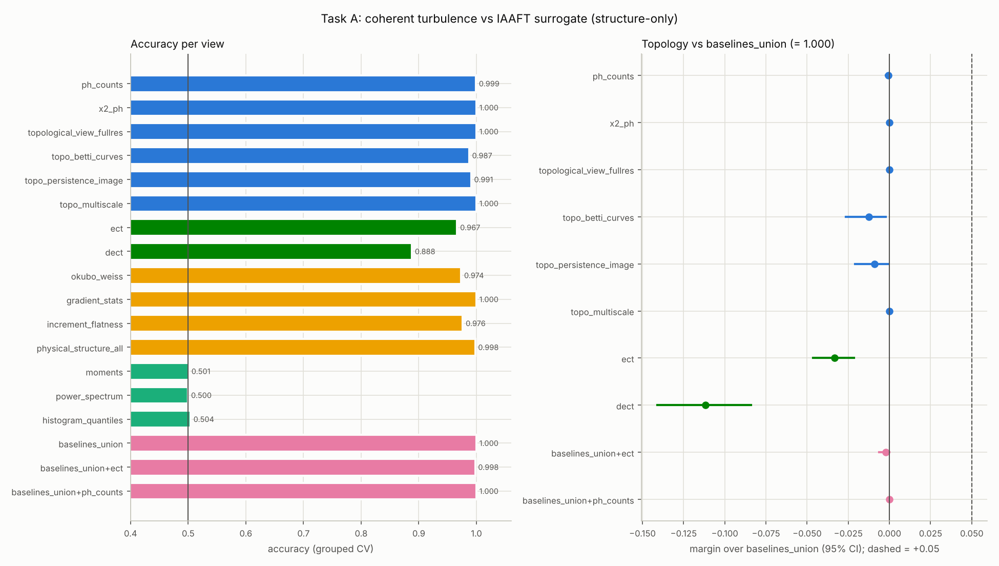
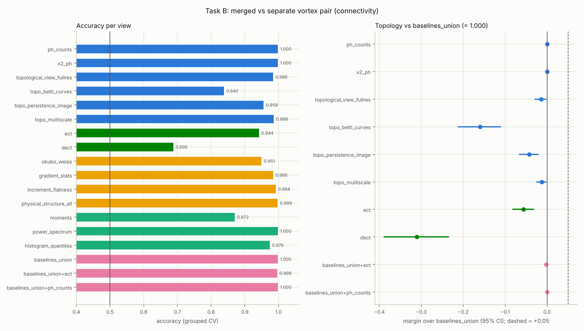
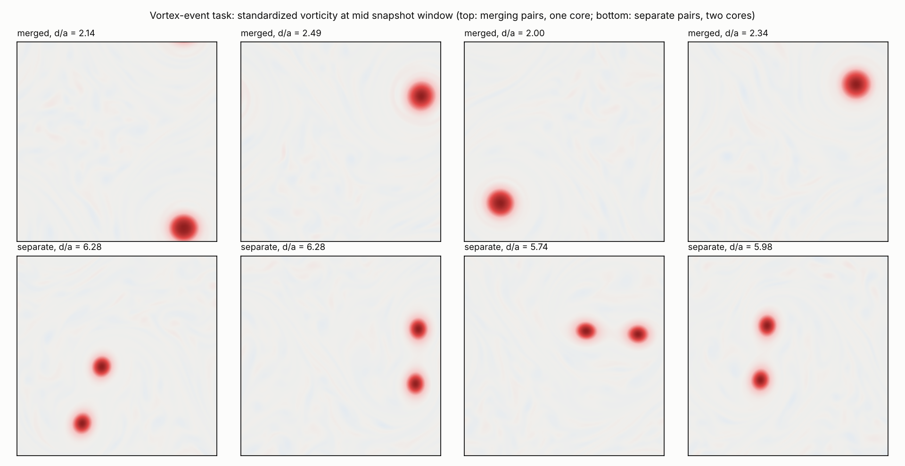
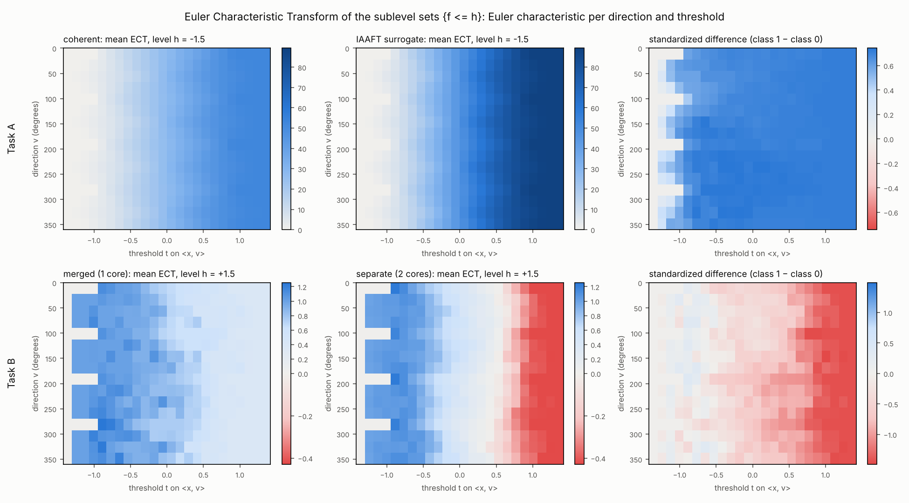
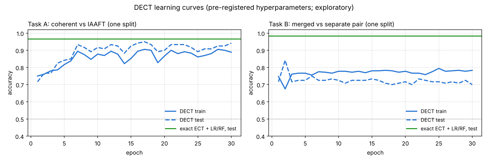

# Richer topology (ECT, DECT) and a genuinely topological task

**Status: pre-registered in commit `bf29025`; results below.** The design,
views and decision rule were committed before any ECT/DECT classification was
run. The code is in `src/descriptor/ect.py`, `src/descriptor/dect.py`,
`src/sims/vortex_events.py` and `src/eval/ect_benchmark.py`; the
configuration is `config/ect_vortex.yaml`.

**Verdict: NO-GO on both tasks.** On the vortex-merger task, topology reads
the label perfectly: H0/H1 counts score 1.000. So do the non-topological
baselines combined (`baselines_union` 1.000), and so does the power spectrum
alone. **Topology does not achieve a ≥ +0.05 margin here; it ties at the
ceiling.** On the IAAFT task the new representations are below the
baselines: ECT 0.967, DECT 0.888, against 1.000.

## Why this study

The clean structure-only benchmark (coherent 2D turbulence vs IAAFT
surrogates) is a confirmed NO-GO for a "better than baselines" claim
(`docs/RESULTS.md`, `docs/NOISE_ROBUSTNESS.md`). Two reasons were identified,
and both match the diagnosis of Turkeš, Montúfar & Otter, "On the
Effectiveness of Persistent Homology" (NeurIPS 2022): persistent homology
helps when the task is genuinely topological, and how the diagrams are
represented matters.

1. **The task.** Separating coherent fields from phase-randomized surrogates
   is a nonlinearity / intermittency test. Okubo–Weiss and gradient
   statistics already solve it (~1.000), so there is no headroom.
2. **The representation.** The descriptor compressed persistence into a few
   summaries.

This study acts on both:

- **A.** It adds an injective, richer topological representation (ECT) and a
  learnable one (DECT), and re-tests them on the existing benchmark.
- **B.** It builds a task whose label depends on global connectivity.

## A. Richer topological representations

### ECT: Euler Characteristic Transform (`src/descriptor/ect.py`)

For a shape K ⊂ ℝ², ECT_K(v, t) = χ(K ∩ {x : ⟨x, v⟩ ≤ t}) for every direction
v ∈ S¹ and threshold t (Turner, Mukherjee & Boyer 2014; Munch 2023). It is
injective on constructible shapes, unlike a handful of persistence
summaries.

- **Shapes.** A field is not a shape, so the ECT is applied to its sublevel
  sets K_h = {f ≤ h} at 5 fixed levels h ∈ {−1.5, −0.75, 0, +0.75, +1.5}
  (field-std units), each as a cubical complex. Every pixel is a closed
  square with its edges and vertices.
- **Grid.** 16 directions uniform on the circle and 24 thresholds on
  [−1.42, 1.42], with coordinates in [−1, 1]².
- **Resolution.** The field is block-averaged to 128² (66 049 cells).
- **Output.** A 5 × 16 × 24 image, 1 920 features.
- **Computation.** Cells enter at the maximum height of their vertices
  (lower-star filtration). For a fixed grid, the whole ECT is one matrix
  product: sublevel-set cell masks @ signed indicator [height ≤ t].
- **Validation.** Unit tests check that the Euler characteristic equals
  8-connected components − 4-connected holes on random images, that an
  annulus gives χ = 0, and that rotating the image by 90° shifts the
  direction axis by D/4.

### DECT: Differentiable ECT (`src/descriptor/dect.py`, optional torch)

Röell & Rieck (2023), arXiv:2310.07630.

- **The layer.** The indicator [height_v(c) ≤ t] becomes
  σ(λ (t − height_v(c))). The 16 directions, the 16 thresholds and the
  sharpness λ (initially 40) are learnable parameters.
- **The input.** The same cubical sublevel-set complexes as the ECT: the
  same 5 fixed levels at 128².
- **The model.** A small CNN head (batch-norm; two 3 × 3 convolutions, the
  direction axis wrap-padded; global average; linear) classifies the DECT
  image. Everything is trained end to end with Adam (lr 3·10⁻³, weight decay
  10⁻⁴, 30 epochs, batch 32) on the same grouped CV splits as every other
  view.
- **Validation.** With very sharp sigmoids the layer reproduces the exact
  ECT (unit test), and gradients reach the directions and thresholds.
- **Optional.** torch is optional: `ect_study.dect.enabled` or `--no-dect`.

## B. A genuinely topological task: merged vs separate vortex pairs

`src/sims/vortex_events.py`.

**Setup.**
- Two identical co-rotating Gaussian vortices (peak 10, radius a = 0.3 in
  the 2π box) are seeded on weak broadband background vorticity (rms 5% of
  the peak, |k| ∈ [4, 24]).
- Position and orientation are random.
- Each pair is evolved, unforced, with the repo's IF-RK4 solver at 256²
  (ν = 2·10⁻⁴, dt = 0.005). The solver gained an optional initial condition
  `w0`; its default path is bit-identical, and a unit test checks this.

**Classes.** Co-rotating vortices merge when their separation is below a
critical d/a (Melander, Zabusky & McWilliams 1988; Meunier et al. 2005):

| class | d/a (uniform) | state in the snapshot window |
|---|---|---|
| 0 "merging" | [2.0, 2.6] | one coherent core |
| 1 "separate" | [5.5, 6.5] | two coherent cores |

The label is the initial separation regime, a physical parameter no
descriptor sees. Everything else is drawn from the same distributions.

**Window and size.** 24 trajectories per class, 10 snapshots each at
t = 10, 12, …, 28: 480 fields and 48 groups for the grouped CV. Every field
is standardized (zero mean, unit variance), as in the IAAFT benchmark.

**Descriptor-free pilot** (`src/eval/vortex_pilot.py`): the number of
coherent cores is counted as the connected regions of {ω > 0.5 max ω}. This
is a validity check, never a feature.

- **Pilot v1** (ν = 5·10⁻⁴, background 10%): every pair merged by
  t ≈ 17–22, even at d/a = 5.4. With those settings the "separate" class
  would not have been separate (`results/vortex_pilot_v1.json`,
  `results/figures/vortex_pilot_v1.png`).
- **Pilot v2** (ν = 2·10⁻⁴, background 5%): d/a ≤ 2.6 is one core from t ≈ 7
  on, and d/a ≥ 5.5 keeps two cores up to t = 29
  (`results/vortex_pilot.json`, `results/figures/vortex_pilot.png`).
- The class ranges and the window were fixed from v2, before any features
  were computed.

## Views and protocol (both tasks)

| Group | Views |
|---|---|
| Topological | `ph_counts` (numbers of H0 / H1 pairs with persistence ≥ 0.5, 1, 2 σ, periodic sublevel filtration), `x2_ph` (sig6 summaries), `topological_view_fullres`, `topo_betti_curves`, `topo_persistence_image`, `topo_multiscale`, **`ect`**, **`dect`** |
| Non-topological | `okubo_weiss`, `gradient_stats`, `increment_flatness`, `physical_structure_all`, `moments`, `power_spectrum`, `histogram_quantiles`, **`baselines_union`** |
| Incremental | `baselines_union+ect`, `baselines_union+ph_counts` |

- **CV.** Repeated StratifiedGroupKFold, 4 folds × 3 repeats; the group is
  the trajectory.
- **Classifiers.** Feature views report the better of LogReg and
  RandomForest. DECT uses its CNN head on the same splits.
- **Uncertainty.** Paired group-bootstrap 95% CIs (2000 resamples) for the
  margin of every topological view over `baselines_union` and over the best
  structure baseline.
- **Multiplicity.** Benjamini–Hochberg over the 16 comparisons (8
  topological views × 2 tasks) against `baselines_union`.

## Decision rule (fixed before running)

- **GO for a task:** at least one of its primary views reaches a margin over
  `baselines_union` of ≥ +0.05, with the 95% CI lower bound > 0 and BH
  q < 0.05.
- **Primary views:**
  - Task A (IAAFT): `ect`, `dect`. These are the new representations under
    test. An honest tie is the expected outcome, because the headroom of
    `baselines_union` on this task was 0.001.
  - Task B (vortex events): `ph_counts`, `ect`, `dect`, i.e. H0/H1 counts,
    ECT and DECT.
- **Reporting.** All other views are reported with their margins and are not
  used for the verdict. Headroom (1 − accuracy of `baselines_union`) is
  reported per task: if it is below 0.05, a GO is arithmetically impossible
  and the verdict says so.

**Disclosure (smoke check, not a result).** Before this commit, only the
offline CI configuration (`config/ect_vortex_smoke.yaml`: 64², 24 fields per
task, 2 DECT epochs) was run, to check the pipeline end to end. On that toy
grid several non-topological baselines (gradient statistics, power spectrum)
already separate merged from separate pairs. So `baselines_union` may
saturate on Task B, and the headroom clause above would then decide the
verdict. The design was not changed after seeing this.

---

## Results

Full run of `config/ect_vortex.yaml`: 8 973 s on 4 cores, DECT enabled.
- Generated tables: [`results/ect_vortex.md`](../results/ect_vortex.md).
- All numbers: [`results/ect_vortex.json`](../results/ect_vortex.json).
- Margins are the paired group-bootstrap differences in accuracy against
  `baselines_union`, on identical folds.

### Verdict per task (pre-registered rule)

| Task | `baselines_union` | headroom | best primary view | margin vs `baselines_union` [95% CI] | ≥ +0.05? | verdict |
|---|---|---|---|---|---|---|
| A: coherent vs IAAFT | 1.000 | 0.000 | `ect` (0.967) | −0.033 [−0.047, −0.022] | no | **NO-GO** |
| B: merged vs separate vortex pair | 1.000 | 0.000 | `ph_counts` (1.000) | +0.000 [+0.000, +0.000] | no | **NO-GO** (tie at the ceiling) |

No topological view on either task has a real advantage (BH q = 1.000 for all
16 comparisons). On both tasks `baselines_union` is already perfect, so the
headroom clause applies: a GO was arithmetically impossible.




### Task A: the IAAFT structure-only benchmark with ECT and DECT

| View | accuracy | margin vs `baselines_union` [95% CI] |
|---|---|---|
| `ect` (exact ECT, 1 920 features) | 0.967 | −0.033 [−0.047, −0.022] |
| `dect` (learned directions / thresholds) | 0.888 | −0.112 [−0.141, −0.084] |
| `ph_counts` (H0/H1 counts) | 0.999 | −0.001 [−0.002, +0.000] |
| `x2_ph`, `topological_view_fullres`, `topo_multiscale` (existing) | 1.000 | +0.000 [+0.000, +0.000] |
| `baselines_union + ect` | 0.998 | −0.002 [−0.006, +0.000] |

For reference, the non-topological views score:

| View | accuracy |
|---|---|
| `gradient_stats` | 1.000 |
| `physical_structure_all` | 0.998 |
| `increment_flatness` | 0.976 |
| `okubo_weiss` | 0.974 |
| `power_spectrum`, `moments`, `histogram_quantiles` (matched by IAAFT) | 0.50 |

The honest tie that was expected did not even happen for the new views. Both
are *below* the older persistence summaries, which already tie at 1.000.
`baselines_union` scores 1.000 here with 3 CV repeats; it was 0.999 with the
5 repeats of `docs/RESULTS.md`.

- **Injectivity does not mean better classification.** It does not help a
  1 920-dimensional view learned from 360 training fields per fold.
- **The ECT adds nothing on top of the baselines** (`baselines_union + ect`
  0.998).
- **One interpretation, not tested here.** For a Gaussian random field, the
  expected Euler characteristic of an excursion set depends only on the
  variance and the second spectral moment (Gaussian kinematic formula;
  Adler & Taylor 2007). IAAFT keeps both: the histogram exactly, the
  spectrum approximately. So an Euler-characteristic view
  can only use the non-Gaussian part of the signal, and gradient statistics
  measure that part more directly.

### Task B: merged vs separate vortex pairs

**Validity (descriptor-free).** The label is exactly the core count. Every
merged field has one core (240 of 240), and every separate field has two
(240 of 240), at every snapshot.



| View | accuracy | margin vs `baselines_union` [95% CI] |
|---|---|---|
| `ph_counts` (H0/H1 counts) | **1.000** | +0.000 [+0.000, +0.000] |
| `x2_ph` (sig6 PH summaries) | 1.000 | +0.000 [+0.000, +0.000] |
| `topological_view_fullres` | 0.986 | −0.014 [−0.028, −0.003] |
| `topo_multiscale` | 0.988 | −0.012 [−0.024, −0.003] |
| `topo_persistence_image` | 0.958 | −0.042 [−0.065, −0.022] |
| `ect` | 0.944 | −0.056 [−0.081, −0.033] |
| `topo_betti_curves` | 0.840 | −0.160 [−0.211, −0.111] |
| `dect` | 0.690 | −0.310 [−0.388, −0.235] |
| `baselines_union + ph_counts` | 1.000 | +0.000 [+0.000, +0.000] |

For reference, the non-topological views score:

| View | accuracy |
|---|---|
| **`power_spectrum`** (alone) | **1.000** |
| `physical_structure_all` | 0.999 |
| `increment_flatness` | 0.994 |
| `gradient_stats` | 0.986 |
| `histogram_quantiles` | 0.976 |
| `okubo_weiss` | 0.951 |
| `moments` | 0.872 |
| `baselines_union` | 1.000 |

**State plainly: topology does not achieve a ≥ +0.05 margin on this task.**
The six H0/H1 counts are a perfect, interpretable detector of the event. But
the margin over `baselines_union` is +0.000 [+0.000, +0.000], and over the
best structure baseline it is +0.001 [+0.000, +0.002]. It is a tie at the
ceiling, not a win.

**Why the non-topological baselines see a connectivity label.** A merger is
not a pure change of connectivity. Circulation and, roughly, vorticity area
are conserved, so the single merged core is about twice the size of each
separate core. Measured descriptor-free on the dataset:

| | merged | separate |
|---|---|---|
| fraction of the domain above half the peak | 0.0122 (one core) | 0.0055 per core, 0.0110 in total |
| spectral centroid (wavenumber) | 3.38 ± 0.30 | 4.40 ± 0.30 |

The centroid ranges barely overlap ([3.00, 4.12] vs [3.96, 5.10]). In this
setting the core count is tied to the core size. For identical cores, the
spectrum fixes the core size and the one-point histogram fixes the occupied
area, so together they fix the number of cores. The label therefore depends
on global connectivity *and* on scale, and the spectrum reads the scale.



The ECT figure shows what the ECT does see. At level +1.5 the cores are holes
of the sublevel set, so the Euler characteristic at the largest thresholds is
lower for separate pairs (two holes) than for merged pairs (one hole). On
average it is about −0.4 vs +0.2 rather than −1 vs 0, because a core cut by
the domain edge is not a hole (see the diagnostics below).

### Exploratory diagnostics (post hoc, not part of the verdict)

Produced by `python -m src.eval.ect_diagnostics --config
config/ect_vortex.yaml`, on the same fields and CV splits:
[`results/ect_vortex_diagnostics.json`](../results/ect_vortex_diagnostics.json)
and `results/figures/dect_learning_curves.png`.

1. **Why ECT (0.944) trails `ph_counts` (1.000) on task B: the boundary.**
   - The ECT is computed on the planar square, while `ph_counts` uses the
     periodic filtration.
   - In 43% of the fields, a core region {f > 1.5} touches the domain edge
     (37% of merged fields, 50% of separate fields). There it is cut open and
     is no longer a hole.
   - The ECT's out-of-fold error rate is 9.0% on those fields and 3.1% on
     the others.
   - A boundary-aware ECT rolls the field periodically so that the quietest
     row and column lie on the edges. It scores 0.998: most of the shortfall
     is the planar complex.
   - It still cannot beat a 1.000 baseline.
2. **Why DECT (0.69–0.89) trails the exact ECT: it under-fits.** One split
   per task was trained with the pre-registered settings and scored after
   every epoch. On task B, training accuracy plateaus at about 0.78 from
   epoch 3, and the final test accuracy is 0.70. On the same split, the exact
   ECT with LogReg fits the training set perfectly and scores 0.983 on test.

   

   - The DECT layer is not the problem: it reproduces the exact ECT (unit
     test).
   - The limits are this implementation's small CNN head and its untuned
     training budget. The head ends in global average pooling, which discards
     the absolute threshold position where χ changes, and that position is
     where the hole count lives.
   - A head that keeps the position (flatten + linear) and some tuning would
     be the first fixes. They were not tried: they would be post hoc, and
     with zero headroom they could not change the verdict.

### What this means

- **Turkeš et al.'s condition is necessary but not sufficient here.** On a
  genuinely topological label, the simplest topological descriptor (six
  H0/H1 counts, periodic) is perfect. But physical events that change
  connectivity also change scale (merger conserves circulation and area), so
  spectra and one-point statistics are perfect too. A margin needs headroom,
  and neither task has any.
- **The richer representations did not help.**
  - The exact ECT is below the old summaries on both tasks. On task B that is
    mostly a boundary effect, which can be fixed.
  - The DECT as implemented here under-fits.
  - The minimal, interpretable counts were the best topological view in this
    study.
- **For the GEM chapter.** The defensible claim is parity plus
  interpretability. Topological counts are an exact, threshold-robust,
  physically meaningful detector of vortex merger, matching the spectrum.
  They do not beat classical diagnostics.
- **What a GO would need.** The label has to be decoupled from scale and
  one-point statistics *by construction*. For example: one vs two cores with
  randomized core sizes, chosen so that the per-class distributions of
  spectral centroid and occupied area coincide. That would be verified
  descriptor-free, as above, before any classification, and pre-registered.
  It was not run here.

### Notes and deviations

- **Unused cache key.** After the run, an unused `feature_cache_dir` key was
  removed from both configs. It had no effect.
- **Single-thread DECT.** DECT took about 1 h per task, because
  `OMP_NUM_THREADS=1` (set for the feature pool) also pins torch to one
  thread. The diagnostics ran with 4 torch threads.
- **Pilot v1 → v2.** The change was descriptor-free and is documented above.
  Both pilots are in `results/`.

## Reproduce

```bash
pip install -r requirements.txt   # torch for DECT (CPU wheels: --index-url https://download.pytorch.org/whl/cpu)
python -m src.eval.vortex_pilot      --config config/ect_vortex.yaml   # descriptor-free pilot
python -m src.eval.ect_benchmark     --config config/ect_vortex.yaml   # full study, ~2.5 h on 4 cores (--no-dect: ~25 min)
python -m src.eval.ect_diagnostics   --config config/ect_vortex.yaml   # exploratory diagnostics, ~15 min
python -m src.eval.ect_benchmark     --config config/ect_vortex_smoke.yaml  # CI-sized pipeline check, ~1 min
```

Task A reuses the cached IAAFT fields of `config/hard_benchmark.yaml` (it
regenerates them, about 30 min, if the cache is missing). The vortex fields
are cached under `data/vortex_events/`. All seeds are fixed in the configs.