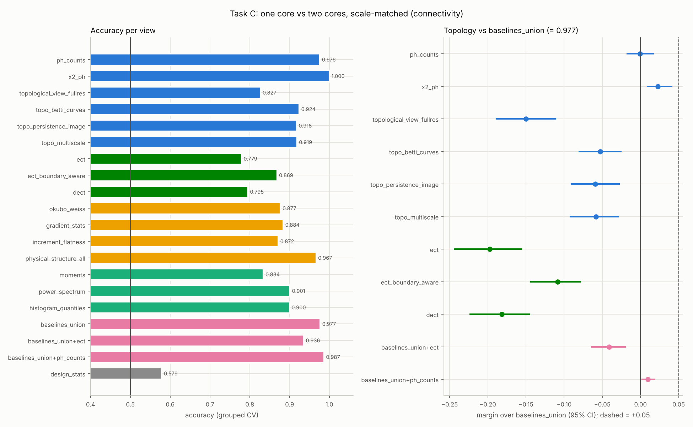
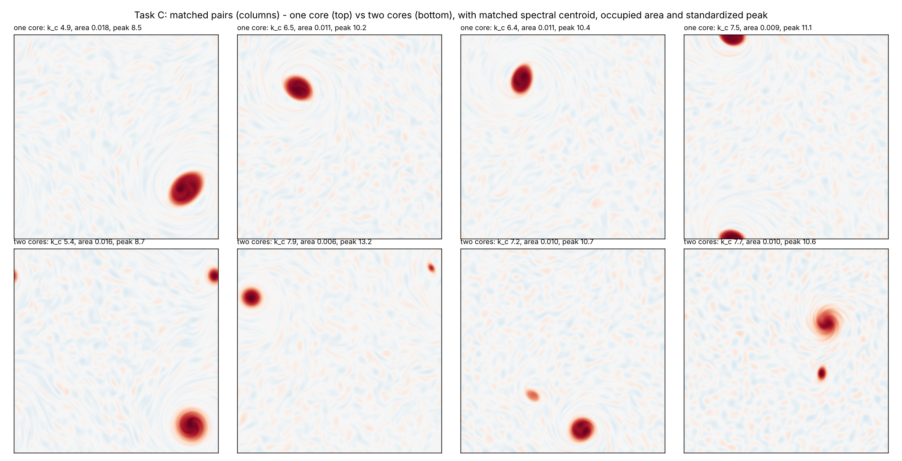
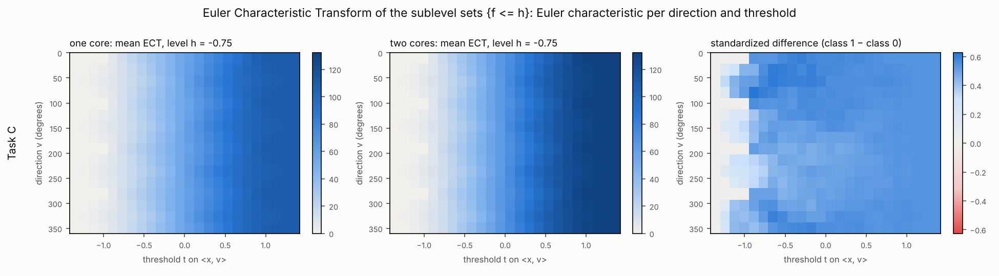

# Task C: a scale-matched core-count task (one vortex core vs two)

**Status: pre-registered in commit `845905c`; results below.** The fields,
the outcome-blind design phase (matching and balance gate), the views and
the decision rule were committed before any descriptor view or benchmark
classifier was computed on task-C data.
- Code: `src/sims/core_count.py` and `src/eval/matched_core_count.py`.
- Configuration: `config/matched_core_count.yaml`.

**Verdict: NO-GO.** Matching removed the easy cues: every single classical
baseline falls to 0.83–0.90. But their union still reaches 0.977, so the
headroom was 0.023 and a +0.05 margin was impossible.
- The H0/H1 counts tie (0.976).
- The persistence summaries `x2_ph` classify perfectly (1.000): a small but
  significant +0.023 [+0.009, +0.041] over all baselines combined (BH
  q = 0.005). It is not a primary view and is below the +0.05 bar.
- ECT and DECT are well below the baselines.

## Why this task

On task B (merged vs separate vortex pairs, `docs/ECT_RESULTS.md`), the H0/H1
counts were perfect, but so was the power spectrum alone. A merger conserves
circulation and roughly area, so the merged core is about twice the size of
each separate core, and the spectrum reads that scale change.

For identical round cores, the count is fixed by non-topological statistics:
the spectrum fixes the core size, the one-point histogram fixes the occupied
area, and count = area / size². Task C breaks that identity:
- the label is still the number of coherent cores (1 vs 2);
- the shapes are randomized so that single cores and pairs overlap in scale
  and occupancy;
- the classes are matched one to one on descriptor-free design statistics
  before any classifier sees them.

This is the follow-up proposed at the end of `docs/ECT_RESULTS.md`.

## Fields (`src/sims/core_count.py`)

Every core has the profile ω(ρ) = A exp(−ρ^p). Here ρ is the (elliptical)
radius in units of the core radius, and p is the steepness: p = 2 is a
Gaussian, a large p is flat-topped.

| | class 0: one core | class 1: two cores |
|---|---|---|
| shape | area-preserving ellipse, aspect ratio U[1.5, 3.5], random orientation | two round cores |
| size | equivalent radius U[0.30, 0.75] | larger radius U[0.30, 0.60]; smaller / larger U[0.35, 0.80] |
| steepness p | U[3, 8] | U[2, 5] |
| peak | A = 10 | 10 for the stronger core; weaker / stronger U[0.6, 1.0] (which core is weaker is random) |
| placement | random | random centre and orientation; separation U[4, 7] × mean radius, at most 3.0 |

**Why these families.** A single core reaches the area-to-scale ratio of a
pair only when it is elongated and flat-topped. A pair reaches the ratio of a
single core only when its cores are unequal. Round monotone profiles are
stable. Elongated cores can pinch off or shed fragments; the validity check
below removes those snapshots.

**Shared setup (both classes):**
- Background: weak broadband vorticity (rms 5% of the peak, |k| ∈ [4, 24]),
  as in task B.
- Solver: unforced IF-RK4 at 256² (ν = 2·10⁻⁴, dt = 0.005).
- Snapshots: t = 1.0, 1.5, …, 4.5 (8 per trajectory).
- Pool: 120 trajectories per class, 1 920 snapshots in total.
- Every field is standardized (zero mean, unit variance).
- The CV group is the trajectory.

## Design phase (outcome-blind; Rubin 2007)

Only the core count and four design statistics are computed in this phase. No
descriptor view and no benchmark classifier is involved.

1. **Validity.** Keep a snapshot only if its descriptor-free core count
   (connected regions of {ω > 0.5 max ω} on the torus) equals the design: 1
   or 2.
2. **Design statistics.**
   - spectral centroid: power-weighted mean |k|;
   - spectral width: power-weighted SD of |k|;
   - occupied area: fraction of the domain above half the peak;
   - standardized peak: max / std.

   Area and peak enter in logs.
3. **Propensity-score matching** (Rosenbaum & Rubin 1983).
   - A logistic regression of the class on the standardized design
     statistics, expanded to linear, squared and pairwise terms (so variances
     are balanced too), is fitted on the valid pool.
   - Matching is greedy and one to one on the logit, without replacement,
     closest pairs first.
   - The caliper is 0.2 SD of the logit (Austin 2011).
4. **Balance gate** on the matched set. The task is analysed only if all four
   checks pass:
   - every |standardized mean difference| < 0.1;
   - every variance ratio in [0.5, 2];
   - at least 120 matched pairs;
   - a grouped-CV logistic regression on the four design statistics predicts
     the class with AUC ≤ 0.60.
5. **Freeze.** The matched set is stored with a hash of its indices. The
   analysis refuses to run if the gate failed or the set changed.

**Pilots** (different seed, 24 trajectories × 4 snapshots per class;
`results/core_count_pilot_v{1,2,3}.json` and figures):

| pilot | single core | pair | matching | outcome |
|---|---|---|---|---|
| v1 | round | independent radii in [0.2, 0.5] | Mahalanobis, caliper 0.25 | 0 pairs. The classes differ jointly: area × centroid² has median 0.32 vs 0.47, the count = area / size² identity. |
| v2 | elliptical, aspect up to 3 | same as v1 | same | 0 pairs. Propensity AUC of the design statistics stays about 0.96 (at t = 0). |
| v3 | ranges above | ranges above | linear propensity | 50 pairs. Means balanced, but variance ratios about 0.5. |

- The ranges for v3 were chosen at t = 0, by the propensity AUC of the design
  statistics (0.94 → 0.66).
- After v3, the propensity model became quadratic, chosen on the cached v3
  pool.
- All pilot decisions used design statistics and core counts only.

**Design phase on the final pool** (seed 0; `results/matched_core_count_design.json`,
`results/figures/core_count_matching.png`). It was run once with the settings
above and passed the gate on the first attempt. Nothing was iterated on the
final pool.

- **Pool:** 240 trajectories, 1 920 snapshots (840 s on 4 cores).
- **Validity:** 93.3% of one-core snapshots and 97.3% of two-core snapshots
  have the designed core count. The rest are dropped.
  - Dropped one-core snapshots: counts of 2 (45), 3 (13), 4 (4), 5 and 8
    (1 each). Elongated cores pinch off or shed fragments above half the peak.
  - Dropped two-core snapshots: counts of 1 (6) and 3 to 5 (20).
- **Balance:**

  | design statistic | SMD before | SMD after | variance ratio before | variance ratio after |
  |---|---|---|---|---|
  | spectral centroid | +0.15 | −0.002 | 0.72 | 1.04 |
  | spectral width | −0.49 | +0.027 | 0.65 | 0.99 |
  | occupied area (log) | −0.24 | +0.026 | 0.59 | 1.08 |
  | standardized peak (log) | +0.36 | −0.008 | 0.54 | 1.06 |
  | grouped-CV AUC of LogReg on the four statistics | 0.83 | **0.46** | | |

- **Matched set:** 436 pairs, so 872 fields.
  - 200 trajectories: 107 one-core and 93 two-core.
  - All 8 snapshot times are represented (86–142 fields each).
  - Set hash `dcb2434ec859aba3`.
- **The matched set is typical of the pool.** Median generation parameters
  barely move:
  - one-core aspect ratio 2.71 → 2.61, steepness 5.29 → 5.23;
  - two-core size ratio 0.56 → 0.54, amplitude ratio 0.76 → 0.75.

## DECT head (developed on task B only)

On task B, the original DECT under-fitted. Its head ends in global average
pooling ("gap"), which discards where along the threshold axis the Euler
characteristic changes (`docs/ECT_RESULTS.md`, diagnostics).

- **Candidate.** `src/descriptor/dect.py` gains a "flat" head: the same two
  convolutions, then flatten and a linear layer. "gap" stays the default, so
  tasks A and B are reproducible.
- **Development.** `src/eval/dect_dev.py` trains both heads on two task-B
  splits (repeat 0, folds 0 and 1), with the unchanged training budget:
  30 epochs, batch 32, Adam lr 3·10⁻³, weight decay 10⁻⁴.
- **Selection rule, written before the development run finished:** use "flat"
  for task C if its mean final test accuracy on the two task-B splits is
  higher than that of "gap"; otherwise keep "gap".
- No task-C data is used for this choice.

**Development result** (`results/dect_head_dev.json`,
`results/figures/dect_head_dev.png`):

| head | final train accuracy (split 0 / 1) | final test accuracy (split 0 / 1) | mean test |
|---|---|---|---|
| gap (original) | 0.783 / 0.775 | 0.700 / 0.717 | 0.708 |
| **flat** | 1.000 / 1.000 | 0.908 / 0.917 | **0.912** |

**Task C uses `head: flat`**, by the rule above.
- The original head's split-0 numbers reproduce the earlier task-B
  diagnostic exactly.
- Task B's exact ECT with LogReg still scores higher (0.944 in the full CV).
  So DECT remains a weaker learner here, but it no longer under-fits.

## Views

| Group | Views |
|---|---|
| Topological | `ph_counts` (H0 / H1 counts, periodic), `x2_ph`, `topological_view_fullres`, `topo_betti_curves`, `topo_persistence_image`, `topo_multiscale`, **`ect`**, **`ect_boundary_aware`**, **`dect`** |
| Non-topological | `okubo_weiss`, `gradient_stats`, `increment_flatness`, `physical_structure_all`, `moments`, `power_spectrum`, `histogram_quantiles`, **`baselines_union`** |
| Incremental | `baselines_union+ect`, `baselines_union+ph_counts` |
| Sanity | `design_stats` (the four matching statistics; expected near chance) |

- **`ect_boundary_aware`** is new here. It is the exact ECT after a periodic
  roll that puts the quietest row and column on the domain edges. On task B
  it was a post-hoc diagnostic; here it is pre-registered.
- **Protocol.** As in the ECT study: repeated StratifiedGroupKFold
  (4 folds × 3 repeats; group = trajectory); best of LogReg / RF for feature
  views; paired group-bootstrap 95% CIs (2 000 resamples).

## Decision rule (fixed before running)

- **GO** if at least one primary view reaches all three:
  - margin over `baselines_union` ≥ +0.05;
  - 95% CI lower bound > 0;
  - Benjamini–Hochberg q < 0.05, over the 9 topological views of task C.
- **Primary views:** `ph_counts`, `ect`, `ect_boundary_aware`, `dect`.
- **Headroom** (1 − accuracy of `baselines_union`) is reported. If it is
  below 0.05, a GO is arithmetically impossible and the verdict says so.
- All other views, and the margins over the best single structure baseline,
  are reported but not used for the verdict.

**Stated in advance: what could still give the label away.**
- **Two-point statistics.** Matching the spectral centroid and width does not
  remove every two-point signature of a pair. Two cores at distance d add a
  cross-correlation peak at lag d, which shows up as oscillations
  ∝ J0(k d) in the radially averaged spectrum; a single elliptical core has
  none.
- **Edges and gradients.** Two cores have more edge per unit area than one,
  which gradient and increment statistics can see.

The baselines may therefore still separate the classes. If they do, the
verdict is NO-GO, and the report names the baseline that does it.

---

## Results

Pre-registered run of `config/matched_core_count.yaml` on the frozen matched
set (`dcb2434ec859aba3`; 872 fields, 200 trajectories). It took 2 518 s on 4
cores, with DECT enabled (flat head).
- Generated tables: [`results/matched_core_count.md`](../results/matched_core_count.md).
- All numbers: [`results/matched_core_count.json`](../results/matched_core_count.json).

### Verdict (pre-registered rule): **NO-GO**

| `baselines_union` | headroom | best primary view | margin vs `baselines_union` [95% CI] | ≥ +0.05? |
|---|---|---|---|---|
| 0.977 | 0.023 | `ph_counts` (0.976) | −0.001 [−0.017, +0.017] | no |

**Topology does not achieve a ≥ +0.05 margin on this task, and it could
not have.**
- After matching, all baselines combined still reach 0.977, so the largest
  possible margin was 0.023.
- The H0/H1 counts tie them.
- No primary view has a real advantage.

**What the matching did achieve.** On task B, a single baseline (the power
spectrum) was perfect. Here every single baseline drops to 0.83–0.90, and
only their combinations come close to topology:

| view | accuracy |
|---|---|
| `x2_ph` (sig6 persistence summaries) | **1.000** |
| `baselines_union + ph_counts` | 0.987 |
| `baselines_union` | 0.977 |
| `ph_counts` (H0 / H1 counts) | 0.976 |
| `physical_structure_all` (Okubo–Weiss + gradients + increments) | 0.967 |
| `topo_betti_curves` / `topo_multiscale` / `topo_persistence_image` | 0.924 / 0.919 / 0.918 |
| `power_spectrum` | 0.901 (LogReg 0.729) |
| `histogram_quantiles` | 0.900 |
| `gradient_stats` / `okubo_weiss` / `increment_flatness` | 0.884 / 0.877 / 0.872 |
| `ect_boundary_aware` | 0.869 |
| `moments` | 0.834 |
| `topological_view_fullres` | 0.827 |
| `dect` (flat head) | 0.795 |
| `ect` | 0.779 |
| `design_stats` (the four matching statistics; sanity) | 0.579 (LogReg 0.467) |



**One secondary result to report, and not over-read.**
- **The finding.** The sig6 persistence summaries (`x2_ph`) classify every
  field correctly.
  - Over `baselines_union` this is a margin of **+0.023 [+0.009, +0.041]**,
    BH q = 0.005, inside the pre-registered family of nine comparisons.
  - Over the best structure baseline it is +0.033 [+0.017, +0.051].
- **What it is.** This is the first topological view in this project with an
  advantage over all baselines combined whose CI excludes zero on clean
  fields.
- **What it is not.**
  - It is not a primary view.
  - It is below the +0.05 bar, which the headroom made unreachable anyway.
  - So it does not turn the verdict into a GO.
- **Adding counts to the baselines.** The H0/H1 counts add a little to the
  baselines: `baselines_union + ph_counts` scores 0.987, +0.010
  [+0.002, +0.019].



**The richer representations lost again.**
- **ECT.** The ECT (0.779; boundary-aware 0.869) and DECT (0.795) are far
  below the persistence views.
- **Why the ECT figure suggests this happens.** The classes differ most at
  level h = −0.75, in the background, not at the cores. There the Euler
  characteristic is about 100–130 per field, made up of background
  components, while the core count differs by one.
  - An Euler characteristic has no persistence filter, so the
    one-structure difference is buried in background topology.
  - Persistence-based counts (thresholds 0.5, 1, 2 σ) and summaries filter
    it out.
- **Betti curves and persistence images** (0.92) sit in between.



### Exploratory diagnostics (post hoc, not part of the verdict)

`python -m src.eval.core_count_diagnostics --config config/matched_core_count.yaml`
writes [`results/matched_core_count_diagnostics.json`](../results/matched_core_count_diagnostics.json).
It uses the same matched set and CV.

1. **No single family of baselines carries the residual cue; it is
   redundant.**

   | union variant | accuracy |
   |---|---|
   | full union (rebuilt, same as the analysis) | 0.977 |
   | without one-point stats / without spectrum / without structure stats | 0.980 / 0.964 / 0.960 |
   | only one-point / only spectrum / only structure stats | 0.899 / 0.895 / 0.967 |

2. **It does not grow with time.**
   - `baselines_union` is 0.96–0.99 at every snapshot time from t = 1.0 to
     4.5, with no trend. Stirring of the background by the cores is not the
     main leak.
   - `x2_ph` is 1.000 at every time; `ph_counts` is 0.945–1.000, lowest at
     the earliest times.
3. **Where the count went: profile shape.** This is a descriptor-free check
   on the matched set.
   - A single core can only match a pair's area-to-scale ratio by being
     elongated *and* flat-topped. So the matched classes still differ in
     profile steepness: median p = 5.5 for single cores vs 3.4 for pairs.
   - This shows in the one-point distribution. The ratio of the area above
     ¾ of the peak to the area above ½ of the peak is 0.66 vs 0.45.
   - Histogram quantiles and gradient statistics read that shape.
   - Matching four summaries did not remove the count from non-topological
     statistics. It moved it into a statistic that was not matched (profile
     shape) and into two-point structure. The power spectrum needs a
     nonlinear classifier (LogReg 0.729, RF 0.901), as expected from the
     interference term stated in advance.

### What this means

- **The decoupling is partial, and probably cannot be complete.** In this
  family of fields the classical statistics jointly determine the core count.
  Matching scale, occupancy and peak removes the easy cues: no single
  baseline exceeds 0.90. But the count re-appears in profile shape and
  two-point structure, and the combination of baselines reaches 0.977.
  Matching profile shape as well would leave less headroom still. Matching
  every baseline statistic leads back to the IAAFT problem, where coherent
  cores cannot survive.
- **Topology is the most direct and the most robust reader of the count.**
  The sig6 persistence summaries are perfect at every time, and the six H0/H1
  counts match the full union of 136 classical features. It is not a large
  margin: the best is +0.023, and the pre-registered rule needed +0.05.
- **For the GEM chapter: a defensible claim.** On a scale-matched
  core-count task, persistent-homology summaries classify perfectly. They
  beat a strong union of classical diagnostics by a small but significant
  margin, +0.023 [+0.009, +0.041]. The individual classical diagnostics
  (Okubo–Weiss, gradients, spectrum) fall to 0.87–0.90.
- **What is not defensible.** A ≥ +0.05 "topology wins" claim. Three
  pre-registered tests (tasks A, B and C) have now ended without one.
- **The representation matters, in the opposite direction from expected.**
  Persistence-filtered counts and summaries beat the injective ECT and the
  learned DECT. This is consistent with Turkeš et al.: the right
  representation is the one that encodes the task's invariant (number of
  persistent structures), not the richest one.

## Reproduce

```bash
pip install -r requirements.txt      # torch is optional (DECT)
python -m src.eval.core_count_pilot      --config config/matched_core_count.yaml --tag _v3  # descriptor-free pilot
python -m src.eval.dect_dev              --config config/ect_vortex.yaml                     # DECT head on task B
python -m src.eval.matched_core_count    --config config/matched_core_count.yaml --design    # outcome-blind design, ~15 min
python -m src.eval.matched_core_count    --config config/matched_core_count.yaml             # pre-registered analysis, ~45 min
python -m src.eval.core_count_diagnostics --config config/matched_core_count.yaml            # exploratory, ~5 min
python -m src.eval.matched_core_count    --config config/matched_core_count_smoke.yaml --design  # CI-sized check
python -m src.eval.matched_core_count    --config config/matched_core_count_smoke.yaml
```

All seeds are fixed in the configs. The pool (float32 fields) and the matched
set are cached under `data/core_count/` (git-ignored). The analysis checks
the matched set against the hash in the design record.
