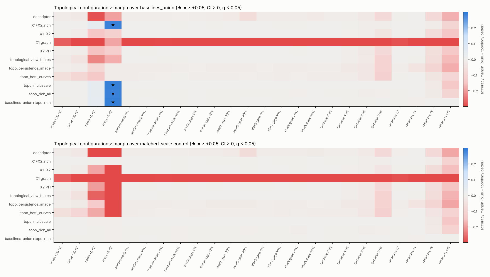
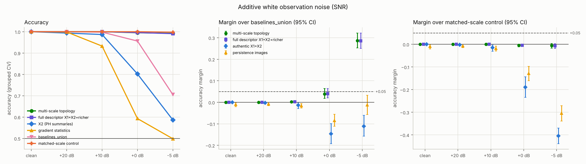
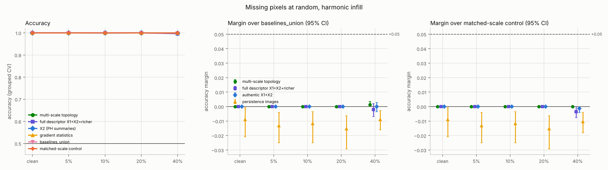
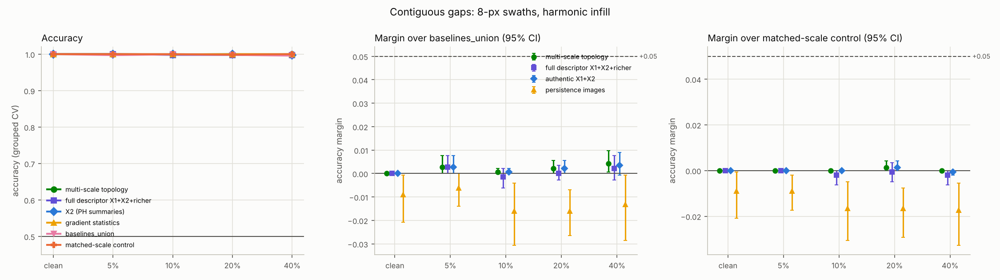
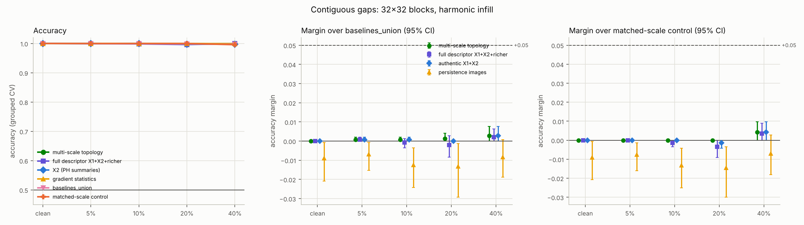
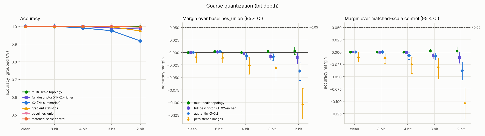
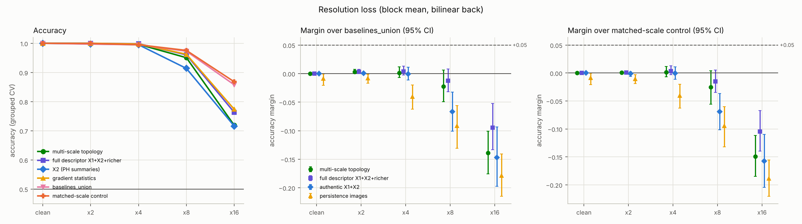

# Topological robustness on degraded geophysical fields

**Status: DONE. Verdict: the +0.044 lead does NOT generalize.** The design and
decision rule above the line were committed (`cfa7181`) before any degraded
condition was evaluated: this file, `config/noise_robustness.yaml`,
`src/eval/degradation.py`, `src/eval/robustness_sweep.py` and
`src/baselines/multiscale.py`. Results are below the line.

## Question

`docs/RESULTS.md` closed the clean-field Go/No-Go as **NO-GO**: on the
structure-only benchmark (coherent 2D turbulence vs IAAFT surrogates),
`baselines_union` reaches ≥ 0.989, so no descriptor can show a +0.05
margin. It left one exploratory lead. At 0 dB SNR the multi-scale topological
filtration (`topo_multiscale`) scored 0.999 vs 0.955 for `baselines_union`,
a margin of +0.044 [+0.024, +0.067]. The same analysis noted that this edge
vanished when every feature set got a common Gaussian low-pass, so it may be
denoising rather than topology.

This study turns that hint into a systematic test:

> Under realistic degradations of satellite / reanalysis fields, does any
> topological configuration show a **real, CI-backed ≥ +0.05** accuracy
> advantage over `baselines_union`? Does the multi-scale lead generalize
> across degradation types, and does it survive a baseline that gets the same
> multi-scale smoothing?

## Data and protocol (unchanged from the hard benchmark)

- **Fields.** The cached 256² benchmark: 240 coherent fields (k_f ∈ {4, 8, 16},
  8 trajectories each, 10 snapshots) and their 240 IAAFT surrogates
  (spectrum-final; same power spectrum, same histogram to 0.023 σ).
  `config/noise_robustness.yaml` inherits `config/hard_benchmark.yaml`, so the
  cache key and the fields are identical.
- **Task.** Binary, coherent vs surrogate, pooled. This is the primary task of
  the hard benchmark.
- **CV.** Repeated StratifiedGroupKFold (4 folds × 3 repeats; group =
  trajectory, so a field, its surrogate and every correlated snapshot of a run
  share a fold). For every feature set the better of LogReg and RandomForest
  is reported, as in the hard benchmark.
- **Uncertainty.** Paired group-bootstrap 95% CIs (2000 resamples of
  trajectories) for every margin, plus a one-sided bootstrap p (margin ≤ 0).
  Benjamini–Hochberg is applied over the whole family: every topological
  configuration × degraded condition × reference.

## Degradation models

All models are applied **identically to both classes**:

- masks and gap positions come from a seed that depends only on the pair, so
  a coherent field and its own surrogate lose exactly the same pixels;
- noise is independent per field, so the classes are matched in expectation.

Every degraded field is re-standardized. Four levels per model, plus the
clean reference:

| Model | Levels | Notes |
|---|---|---|
| 1. Additive white observation noise | SNR +20, +10, 0, −5 dB (η = 0.10, 0.32, 1.00, 1.78) | linear; spectrum and histogram stay matched in expectation |
| 2. Random missing pixels | 5, 10, 20, 40 % | harmonic (Laplace) infill, parameter-free |
| 3a. Contiguous gaps: swaths | ≈5, 10, 20, 40 % (2, 3, 6, 13 bands of 8 px; axis random per pair) | harmonic infill |
| 3b. Contiguous gaps: blocks | ≈5, 10, 20, 40 % (3, 6, 13, 26 blocks of 32 × 32) | harmonic infill |
| 4. Coarse quantization | 8, 4, 3, 2 bits on [−4σ, 4σ] | pointwise nonlinear: spectra of the two classes may differ after it (see leak detectors) |
| 5. Resolution loss | ×2, ×4, ×8, ×16 block-mean, periodic bilinear back to 256² | linear |

Models 1, 2, 3a, 3b and 5 are linear in the data for a fixed mask, so they
keep the classes matched in expected power spectrum. Quantization is
nonlinear. The two leak detectors (`power_spectrum`, `histogram_quantiles`)
are reported in every condition so any spectral or one-point cue stays
visible.

## Feature sets

| Group | Sets |
|---|---|
| Full descriptors | `descriptor` (legacy spectral + topological view), `x1x2_rich` (authentic X1 + X2 + all richer topology) |
| Authentic views | `x1x2`, `x1_graph` (X1), `x2_ph` (X2, `sig6` summaries) |
| Topology vectorizations | `topological_view_fullres` (8 summaries at 256²), `topo_persistence_image`, `topo_betti_curves`, `topo_multiscale`, `topo_rich_all` |
| Structure baselines | `okubo_weiss`, `gradient_stats`, `increment_flatness`, `physical_structure_all` |
| Reference | `baselines_union` (every non-topological baseline) |
| Matched-scale control (new) | `physical_structure_ms`, `baselines_union_ms` = `baselines_union` + Okubo–Weiss / gradient / increment / moments / quantiles on the **same** Gaussian pyramid as `topo_multiscale` (σ = 1, 2, 4, 8 px) |
| Leak detectors | `power_spectrum`, `histogram_quantiles` |
| Incremental | `baselines_union+topo_rich`, `baselines_union_ms+topo_multiscale` |

All descriptor and baseline hyper-parameters are the hard benchmark's
pre-registered constants. The matched-scale control reuses the
multi-scale filtration's own pyramid code (`_gaussian_lowpass_periodic`,
`MS_SCALES`), so the comparison is like for like.

## Decision rule (fixed before running)

- **Real advantage** of a configuration at one (model, level): margin over
  `baselines_union` ≥ +0.05, 95% CI lower bound > 0, and BH q < 0.05. The
  table also flags the stricter case where the CI lower bound itself is
  ≥ +0.05.
- **Topology-specific** advantage: the same three conditions hold against
  the matched-scale control `baselines_union_ms` too. Otherwise the edge is
  attributed to the built-in multi-scale smoothing, not to topology.
- **Generalization of the lead** (`topo_multiscale`): a real advantage in ≥ 3
  of the 5 degradation models, at any level. Swaths and blocks count as one
  model, "contiguous gaps".
- **Conclusions:**
  - *Supports a dedicated "topological robustness on degraded geophysical
    fields" paper* only if the lead generalizes **and** is topology-specific
    in ≥ 2 models.
  - *Generalizes, but as denoising* if it generalizes against
    `baselines_union` only.
  - Otherwise *does not generalize*.

---

## Results

Run of 2 Nov 2026: 25 conditions (clean + 6 sweeps × 4 levels), 21 feature
sets, 552 comparisons under BH; 1 h 52 min on 4 CPU cores. Generated tables:
[`results/noise_robustness.md`](../results/noise_robustness.md) (per model:
accuracy of every set, margins over `baselines_union` and over the
matched-scale control). Machine-readable:
[`results/noise_robustness.json`](../results/noise_robustness.json). Figures:
`results/figures/robustness_<model>.png` and
`results/figures/robustness_margin_heatmap.png`.

**Reproduction check.** The 256² cache was regenerated in this session from
`config/hard_benchmark.yaml`, and it has the same cache key
(`coherent_4653babc3662`). The clean condition reproduces the hard benchmark:

| Set | here (3 repeats) | hard benchmark (5 repeats) |
|---|---|---|
| legacy descriptor | 0.989 | 0.989 |
| X1 | 0.688 | 0.692 |
| Okubo–Weiss | 0.974 | 0.974 |
| gradient statistics | 1.000 | 1.000 |
| `power_spectrum` / `histogram_quantiles` | 0.500 / 0.504 | 0.500 / 0.503 |

The noise draws differ from `noise_sweep.py` (new seed stream), and the 0 dB
lead reproduces: +0.039 [+0.018, +0.065] here vs +0.044 [+0.024, +0.067]
before.

### Verdict

**The multi-scale lead does not generalize, and where it is large it is
denoising, not topology. This does not support a dedicated "topological
robustness on degraded geophysical fields" paper.**

- **Against `baselines_union`.** A real advantage (≥ +0.05, CI above 0, BH
  q < 0.05) appears in **one model at one level**: white noise at −5 dB SNR.
  It holds only for the configurations that contain the multi-scale
  filtration:

  | Configuration | margin [95% CI] |
  |---|---|
  | `topo_multiscale` | +0.287 [+0.253, +0.322] |
  | `topo_rich_all` | +0.285 [+0.251, +0.321] |
  | full descriptor `x1x2_rich` | +0.285 [+0.250, +0.322] |
  | `baselines_union+topo_rich` | +0.286 [+0.251, +0.322] |

  The rule needs ≥ 3 of 5 models, so the lead fails it.
- **Against the matched-scale control.** This is the same set of
  non-topological diagnostics computed on the same Gaussian pyramid.
  - No topological configuration has a positive margin above +0.004 at any
    of the 24 degraded conditions. The largest margin of any kind is
    +0.012, by the incremental `baselines_union_ms+topo_multiscale` at ×8.
  - At −5 dB the control scores 0.998 and multi-scale topology 0.992, a
    margin of −0.006 [−0.017, +0.004]. The Okubo–Weiss, gradient and
    increment statistics on the pyramid alone (`physical_structure_ms`,
    100 numbers) reach 0.997, so the control's win is not a matter of
    dimension.
- **Every other degradation leaves no headroom or hurts topology.**
  - `baselines_union` stays ≥ 0.995 under random masking, swath gaps, block
    gaps (up to 40%) and quantization (down to 2 bits). There, a ≥ +0.05
    margin is arithmetically impossible, and the largest observed margin is
    +0.005.
  - Under strong resolution loss topology is *worse*: −0.139 [−0.176,
    −0.101] at ×16.

Headroom (1 − accuracy of `baselines_union`) reaches 0.05 in only 2 of the 24
degraded conditions: noise −5 dB (0.294) and resolution ×16 (0.142). Topology
wins the first only through smoothing and loses the second.

### Results table (all models and levels)

`topo_multiscale` is the lead under test. "best topology config" is the
topological configuration with the largest margin over `baselines_union`.
★ = real advantage (≥ +0.05, CI above 0, BH q < 0.05). The matched-scale
control is `baselines_union_ms`.

| Condition | `topo_multiscale` | best topology config | `baselines_union` | matched-scale control | best structure baseline | lead − union [95% CI] | lead − control [95% CI] | best topo − union [95% CI] | leak detectors (spectrum / quantiles) |
|---|---|---|---|---|---|---|---|---|---|
| clean | 1.000 | `topo_multiscale` 1.000 | 1.000 | 1.000 | `gradient_stats` 1.000 | +0.000 [+0.000, +0.000] | +0.000 [+0.000, +0.000] | +0.000 [+0.000, +0.000] | 0.500 / 0.504 |
| noise +20 dB | 1.000 | `topo_multiscale` 1.000 | 1.000 | 1.000 | `physical_structure_all` 1.000 | +0.000 [+0.000, +0.000] | +0.000 [+0.000, +0.000] | +0.000 [+0.000, +0.000] | 0.501 / 0.490 |
| noise +10 dB | 1.000 | `topo_multiscale` 1.000 | 0.998 | 1.000 | `physical_structure_all` 0.997 | +0.002 [+0.000, +0.005] | +0.000 [+0.000, +0.000] | +0.002 [+0.000, +0.005] | 0.541 / 0.526 |
| noise +0 dB | 0.995 | `topo_rich_all` 0.997 | 0.956 | 1.000 | `physical_structure_all` 0.954 | +0.039 [+0.018, +0.065] | -0.005 [-0.011, +0.000] | +0.040 [+0.022, +0.065] | 0.475 / 0.481 |
| noise -5 dB | 0.992 | `topo_multiscale` 0.992 | 0.706 | 0.998 | `physical_structure_all` 0.729 | +0.287 [+0.253, +0.322] ★ | -0.006 [-0.017, +0.004] | +0.287 [+0.253, +0.322] ★ | 0.469 / 0.533 |
| random_mask 5% | 1.000 | `topo_multiscale` 1.000 | 1.000 | 1.000 | `gradient_stats` 1.000 | +0.000 [+0.000, +0.000] | +0.000 [+0.000, +0.000] | +0.000 [+0.000, +0.000] | 0.505 / 0.508 |
| random_mask 10% | 1.000 | `topo_multiscale` 1.000 | 1.000 | 1.000 | `gradient_stats` 1.000 | +0.000 [+0.000, +0.000] | +0.000 [+0.000, +0.000] | +0.000 [+0.000, +0.000] | 0.517 / 0.508 |
| random_mask 20% | 1.000 | `topo_multiscale` 1.000 | 1.000 | 1.000 | `gradient_stats` 1.000 | +0.000 [+0.000, +0.000] | +0.000 [+0.000, +0.000] | +0.000 [+0.000, +0.000] | 0.503 / 0.528 |
| random_mask 40% | 1.000 | `topo_multiscale` 1.000 | 0.999 | 1.000 | `gradient_stats` 1.000 | +0.001 [+0.000, +0.003] | +0.000 [+0.000, +0.000] | +0.001 [+0.000, +0.003] | 0.519 / 0.567 |
| swath_gaps 5% | 1.000 | `topo_multiscale` 1.000 | 0.997 | 1.000 | `gradient_stats` 1.000 | +0.003 [+0.000, +0.008] | +0.000 [+0.000, +0.000] | +0.003 [+0.000, +0.008] | 0.515 / 0.515 |
| swath_gaps 10% | 1.000 | `topo_multiscale` 1.000 | 0.999 | 1.000 | `gradient_stats` 0.999 | +0.001 [+0.000, +0.002] | +0.000 [+0.000, +0.000] | +0.001 [+0.000, +0.002] | 0.496 / 0.540 |
| swath_gaps 20% | 1.000 | `topo_multiscale` 1.000 | 0.998 | 0.999 | `gradient_stats` 1.000 | +0.002 [+0.000, +0.006] | +0.001 [+0.000, +0.004] | +0.002 [+0.000, +0.006] | 0.508 / 0.549 |
| swath_gaps 40% | 1.000 | `topo_multiscale` 1.000 | 0.996 | 1.000 | `gradient_stats` 1.000 | +0.004 [+0.001, +0.010] | +0.000 [+0.000, +0.000] | +0.004 [+0.001, +0.010] | 0.508 / 0.595 |
| block_gaps 5% | 1.000 | `topo_multiscale` 1.000 | 0.999 | 1.000 | `gradient_stats` 1.000 | +0.001 [+0.000, +0.002] | +0.000 [+0.000, +0.000] | +0.001 [+0.000, +0.002] | 0.515 / 0.553 |
| block_gaps 10% | 1.000 | `topo_multiscale` 1.000 | 0.999 | 1.000 | `gradient_stats` 1.000 | +0.001 [+0.000, +0.002] | +0.000 [+0.000, +0.000] | +0.001 [+0.000, +0.002] | 0.489 / 0.584 |
| block_gaps 20% | 1.000 | `topo_multiscale` 1.000 | 0.999 | 1.000 | `gradient_stats` 1.000 | +0.001 [+0.000, +0.004] | +0.000 [+0.000, +0.000] | +0.001 [+0.000, +0.004] | 0.507 / 0.603 |
| block_gaps 40% | 1.000 | `topo_multiscale` 1.000 | 0.997 | 0.996 | `gradient_stats` 0.999 | +0.003 [+0.000, +0.008] | +0.004 [+0.000, +0.010] | +0.003 [+0.000, +0.008] | 0.509 / 0.676 |
| quantize 8 bit | 1.000 | `topo_multiscale` 1.000 | 0.999 | 1.000 | `gradient_stats` 1.000 | +0.001 [+0.000, +0.004] | +0.000 [+0.000, +0.000] | +0.001 [+0.000, +0.004] | 0.515 / 0.506 |
| quantize 4 bit | 1.000 | `topo_multiscale` 1.000 | 1.000 | 1.000 | `gradient_stats` 1.000 | +0.000 [+0.000, +0.000] | +0.000 [+0.000, +0.000] | +0.000 [+0.000, +0.000] | 0.774 / 0.502 |
| quantize 3 bit | 1.000 | `topo_multiscale` 1.000 | 0.999 | 0.998 | `physical_structure_all` 0.998 | +0.001 [+0.000, +0.004] | +0.002 [+0.000, +0.006] | +0.001 [+0.000, +0.004] | 0.948 / 0.498 |
| quantize 2 bit | 0.998 | `topo_multiscale` 0.998 | 0.995 | 0.996 | `physical_structure_all` 0.997 | +0.003 [-0.004, +0.010] | +0.002 [-0.004, +0.010] | +0.003 [-0.004, +0.010] | 0.947 / 0.506 |
| resample x2 | 1.000 | `topo_multiscale` 1.000 | 0.997 | 0.999 | `gradient_stats` 1.000 | +0.003 [+0.000, +0.008] | +0.001 [+0.000, +0.002] | +0.003 [+0.000, +0.008] | 0.496 / 0.647 |
| resample x4 | 0.997 | `x1x2_rich` 0.999 | 0.995 | 0.995 | `physical_structure_all` 1.000 | +0.001 [-0.007, +0.012] | +0.001 [-0.007, +0.012] | +0.003 [-0.003, +0.013] | 0.510 / 0.770 |
| resample x8 | 0.951 | `x1x2_rich` 0.960 | 0.973 | 0.976 | `physical_structure_all` 0.977 | -0.022 [-0.049, +0.006] | -0.025 [-0.056, +0.004] | -0.012 [-0.032, +0.008] | 0.614 / 0.759 |
| resample x16 | 0.719 | `topo_betti_curves` 0.767 | 0.858 | 0.868 | `physical_structure_all` 0.794 | -0.139 [-0.176, -0.101] | -0.149 [-0.185, -0.112] | -0.091 [-0.128, -0.050] | 0.608 / 0.650 |

Full per-model tables, with all 21 sets and all 10 topological
configurations: [`results/noise_robustness.md`](../results/noise_robustness.md).

### Per degradation model

**1. White observation noise.**

- *Topology itself is not noise-robust; only the smoothed, multi-scale
  filtration is.* The single-resolution topological views collapse:

  | View | +10 dB | 0 dB | −5 dB |
  |---|---|---|---|
  | X2 (`sig6` PH summaries) | 0.987 | 0.802 | 0.587 |
  | persistence images | – | 0.872 | 0.694 |
  | Betti curves | – | 0.816 | 0.694 |
  | legacy descriptor | – | 0.669 | 0.512 |
  | authentic X1+X2 | – | 0.810 | 0.594 |

- The derivative-based diagnostics collapse as well. Gradient statistics
  fall to 0.593 at 0 dB and 0.499 at −5 dB; `baselines_union` falls to
  0.956 and 0.706.
- The multi-scale filtration (0.995 at 0 dB, 0.992 at −5 dB) and every
  configuration that contains it stay near 1.
- So do the same classical diagnostics computed on the same pyramid
  (control 1.000 and 0.998). The advantage over `baselines_union` is the
  built-in Gaussian smoothing.

**2. Random missing pixels, harmonic infill (5–40%).**

- Every topological configuration with full-resolution access, every
  structure baseline and `baselines_union` score 0.999–1.000. The largest
  margin is +0.001.
- Harmonic infill of isolated pixels leaves the coherent-vortex signature
  intact for all methods.

**3. Contiguous gaps: swaths and blocks (5–40%).**

- Same picture: `baselines_union` ≥ 0.996 and margins ≤ +0.005 everywhere.
- The one-point leak detector rises with the gap fraction, to 0.595
  (swaths) and 0.676 (blocks) at 40%. Harmonic infill pulls the filled
  values toward the local mean, and how much depends on the field's phase
  structure.
- That is a structural cue, and `baselines_union` contains it, so the
  comparison is stricter for topology, not looser.

**4. Coarse quantization (8, 4, 3, 2 bits).**

- Ceiling everywhere. At 2 bits (4 levels), multi-scale topology scores
  0.998 vs 0.995 for `baselines_union` (+0.003 [−0.004, +0.010]).
- As expected for a pointwise nonlinearity, the power spectrum becomes
  informative after quantization (0.774 at 4 bits, 0.95 at 3 and 2 bits).
  That is again phase information leaking into the spectrum, not a flaw of
  the benchmark.

**5. Resolution loss (block mean ×2 … ×16, bilinear back to 256²).**

- ×2 and ×4 are at ceiling.
- At ×8 and ×16, topology degrades *faster* than the classical diagnostics:

  | Factor | multi-scale topology | best topology config | `baselines_union` | margin of the lead |
  |---|---|---|---|---|
  | ×8 | 0.951 | – | 0.973 | −0.022 [−0.049, +0.006] |
  | ×16 | 0.719 | Betti curves 0.767 | 0.858 | −0.139 [−0.176, −0.101] |

- Averaging over 16 × 16-pixel footprints removes the small-scale extrema
  that the persistence diagrams count. The increment-flatness, gradient and
  spectral parts of `baselines_union` keep more of the coherent/random
  distinction.

### What this means

1. **The exploratory lead is real but narrow, and it is not topological.**
   It reproduces at 0 dB (+0.039) and becomes large at −5 dB (+0.287). It
   comes entirely from the multi-scale filtration's internal Gaussian
   smoothing. A practitioner who smooths before computing the classical
   diagnostics gets the same robustness or better. Any robustness claim for
   topology therefore needs a matched-preprocessing control; without it the
   −5 dB result would look like a strong positive finding.
2. **It does not generalize across realistic degradations.**
   - Missing data (random or contiguous, up to 40%) and quantization
     (down to 2 bits) do not hurt the classical diagnostics on this
     benchmark, so there is no room for an advantage.
   - Resolution loss hurts topology *more* than the baselines.
3. **No support for a dedicated "topological robustness on degraded
   geophysical fields" paper** on this evidence. Under the pre-registered
   rule the verdict is *does not generalize*. Even the one large win
   disappears against the matched-scale control.
4. **What is worth reporting** (e.g. in the SPMAC abstract or a methods note):
   - single-resolution persistence summaries (X2, images, Betti curves) are
     fragile to white observation noise (X2: 1.000 → 0.802 at 0 dB), despite
     the stability theorem. The summaries are dominated by the many
     short-lived noise pairs;
   - a multi-scale filtration restores robustness;
   - the matched-preprocessing control, without which that robustness would
     be misread as a topological advantage;
   - topology's faster failure under resolution loss.

### Caveats

- **Data.** Synthetic, one flow family (forced 2D turbulence), one
  structure-only task (coherent vs IAAFT), whose clean version is saturated.
  A task where classical diagnostics fail *even after* matched smoothing
  (structured or non-Gaussian noise, real reanalysis fields with
  structure-level labels) was not part of this study.
- **Infill and resampling.** Harmonic infill and bilinear regridding are the
  simplest choices. Other infill methods (kriging, DINEOF) could change the
  gap results, but not the headroom argument: `baselines_union` already
  scores ≥ 0.996 there.
- **Matched-scale control.** It has more features than `baselines_union`
  (336 vs 136). Its structure-only part (100 features) reaches the same
  accuracy, so the control's advantage is not dimensionality.
- **Classifier and repeats.** Best of LogReg / RF is reported for every set
  (equally optimistic for all), with 3 CV repeats (as in `noise_sweep.py`).
- **Resolution of the q-values.** BH over 552 one-sided bootstrap p-values
  with 2000 resamples (p floor 0.0005). The −5 dB stars have q = 0.031.
